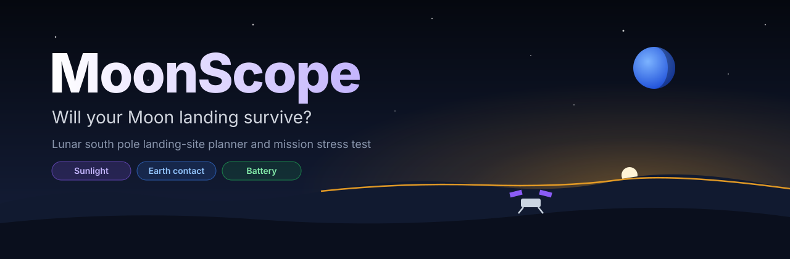
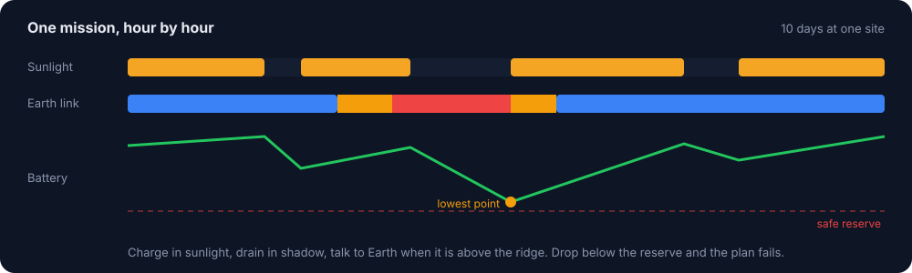
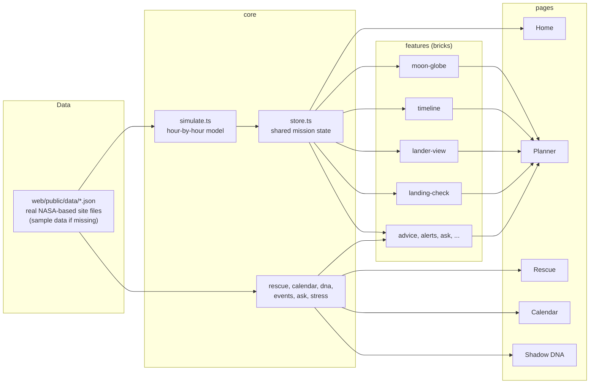

<p align="center">
  
</p>

<h1 align="center">MoonScope</h1>

<p align="center">
  <b>Will your Moon landing survive?</b><br>
  <sub>Simulate every hour of a lunar south pole mission, from sunlight to battery to Earth link, with real NASA data.</sub>
</p>

<p align="center">
  <a href="https://moonscope-two.vercel.app/"><b>Open the live app</b></a> &nbsp;&middot;&nbsp;
  <a href="docs/METHOD.md">Method and validation</a>
</p>

<p align="center">
  
  
  
  
  
  
  
</p>

<p align="center">
  <a href="#what-it-does">What it does</a> &nbsp;&middot;&nbsp;
  <a href="#how-it-works">How it works</a> &nbsp;&middot;&nbsp;
  <a href="#quick-start">Quick start</a> &nbsp;&middot;&nbsp;
  <a href="#architecture">Architecture</a> &nbsp;&middot;&nbsp;
  <a href="#data">Data</a> &nbsp;&middot;&nbsp;
  <a href="#roadmap">Roadmap</a> &nbsp;&middot;&nbsp;
  <a href="#team">Team</a>
</p>

---


https://github.com/user-attachments/assets/6cb768bf-bf57-41f2-bb27-8dd3cce1ca74


At the lunar south pole the Sun never climbs more than a few degrees above the horizon. A ridge a few kilometres away can put a
lander in shadow for days, and the same terrain can hide Earth and cut the radio link. A landing site that looks perfect on one date
can kill the mission two days later, and missing the target by one kilometre can do the same.

> [!IMPORTANT]
> **MoonScope answers one question: *will this mission survive?***
> Pick a site and a landing date, set the lander's battery and power use, and MoonScope simulates every hour of the mission.
> It shows when the panels charge, when Earth is in view, how low the battery falls, and the smallest change that turns a failing plan into a working one.

## What it does

MoonScope has two parts: the **survival guide** (real planning with NASA data) and a **game** (practice).

| Page | Route | Part | What you get |
| :--- | :--- | :--- | :--- |
| **Home** | `#/` | | What MoonScope is, with a live verdict for the current plan |
| **Mission planner** | `#/plan` | Survival guide | The full dashboard: map, sky view, settings, timeline, lander view, what-ifs, landing accuracy check, fixes, alerts, Ask MoonScope and the Mission brief |
| **Survival Calendar** | `#/calendar` | Survival guide | Sixty landing dates coloured by result, with the earliest date the mission fails |
| **Shadow DNA** | `#/sites` | Survival guide | A ring fingerprint of light and Earth contact for every site, side by side |
| **Rescue Mode** | `#/rescue` | Game | Something breaks after touchdown and you have 72 hours to keep the lander alive |

A **How it works** button on every page starts a guided tour, and opens a plain-language guide to every panel.

### Inside the planner

| Panel | Purpose |
| :--- | :--- |
| Lunar map (2D / 3D) | Nine south pole sites, each coloured by its verdict for your settings. Switch between a flat map and a 3D Moon lit by the real Sun |
| Mission settings | Site, custom landing point, landing date, battery, power use, panel efficiency, Earth-contact hours, mission length |
| Local sky | Where the Sun and Earth sit above the horizon right now |
| Timeline | Hour-by-hour sunlight and Earth-link bars with a playable cursor |
| Metrics | Sun height, sunlit time, Earth contact, longest signal loss, lowest battery and the result |
| Lander's-eye view | A 360 degree view of the real terrain around the lander, with the Sun's path and Earth |
| What-if tests | Try changes like landing 5 days late, weaker panels or landing 2 km away, up to 4 at once |
| Compare | Your plan and each what-if side by side, with their battery levels |
| Landing accuracy check | Re-runs the whole mission at 25 points within 2 km of the site, because a lander can miss its target by about 1 km. **Try a landing** drops the lander with a random miss |
| Recommendations | Why the plan fails, plus one-click fixes: land later, switch site, bigger battery, less power, better panels |
| Mission alerts | Readable events: sunset, signal loss, battery below the safe minimum. Click one to jump there |
| Ask MoonScope | Type *"land 3 days late with 20% weaker panels"* and the plan updates |
| Mission brief | A one-page report of the plan that you can print or save as a PDF |

> [!TIP]
> Ask MoonScope needs **no AI key**. It works fully offline.

### Rescue Mode (game)

Choose a crisis (dust on the panels, a late landing or a stuck heater). The game starts just before the longest night of the month,
with the battery at 35%. Our rover sits in the 360 degree view and acts out every move. Every move re-runs the simulator:

| Move | Effect | Cost |
| :--- | :--- | :--- |
| Drive 1 km toward sunlight | Climbs about 100 m, which lowers the horizon by 0.5 degrees so the Sun clears it sooner | 2 hours and 4 kWh, up to 3 times |
| Switch off instruments | Cuts power use by 40% | Science pauses |
| Hibernate for 6 hours | Power use drops to 0.4 kW | No science, no contact |
| Tilt panels to the Sun | 15% more power from the panels | Once only |

Doing nothing always loses. A good start: switch off instruments, drive toward the light 3 times, then tilt the panels.
The hardest sites also need hibernation.

## How it works

<p align="center">
  
</p>

For every hour of the mission MoonScope checks three things:

1. **Is the Sun above the local horizon?** The Sun's elevation and direction are compared with the terrain height in that direction.
   If it clears the ridge, the panels charge.
2. **Can the lander see Earth?** The same test for Earth gives a good, weak or lost link.
3. **What is left in the battery?**

```text
battery[h + 1] = min(capacity, battery[h] + solar_power[h] - power_use)
solar_power[h] = sunlit[h] ? 1.361 kW/m2 x 10 m2 x panel_efficiency : 0
```

The plan **fails** if the battery drops below the safe minimum (25% of the battery), or if daily Earth contact falls short of what
the mission needs. It is **at risk** if it only just passes. MoonScope then re-runs the mission with later landing dates, other sites,
a bigger battery, less power and better panels to find the smallest fix, and stress-tests a working plan against 1, 3 and 5 day delays.

| Result | Meaning |
| :--- | :--- |
| **FEASIBLE** | Battery stays above the safe minimum and Earth contact is enough |
| **AT RISK** | The plan only just passes |
| **INFEASIBLE** | Battery drops below the safe minimum, or Earth contact falls short |

## Quick start

Use the live app: **<https://moonscope-two.vercel.app/>**

To run it yourself you need **Node.js 20 or later** and **pnpm**.

```bash
git clone https://github.com/NoshinSyaraPromitee/Team_Merge_Conflict_Nasa_Space_App_Challenge.git
cd Team_Merge_Conflict_Nasa_Space_App_Challenge/web
pnpm install
pnpm dev
```

Open <http://localhost:5173> and you are in.

| Command (inside `web/`) | What it does |
| :--- | :--- |
| `pnpm dev` | Start the dev server with hot reload |
| `pnpm build` | Type-check and build to `web/dist` |
| `pnpm preview` | Serve the production build locally |
| `pnpm test` | Run the web app tests (Vitest) |

The Python data pipeline and its tests live in `pipeline/` and `scripts/` (run `python -m pytest` from the repo root).

## Architecture

MoonScope is built like Lego. Every panel is a self-contained **brick** that reads shared state from `core` and draws with pieces
from `ui`. Bricks never import each other, so five people can work on five bricks without merge conflicts.



<details>
<summary><b>Folder structure</b></summary>

<br>

```text
Team_Merge_Conflict_Nasa_Space_App_Challenge/
|-- docs/                   README images, METHOD.md (method and validation)
|-- pipeline/               Python: LOLA terrain, horizons, illumination, Earth link, export
|-- scripts/                Python: SPICE Sun and Earth ephemeris, validation plots and tests
|-- kernels/                NASA NAIF SPICE kernels (DE440, Moon frames, leap seconds)
|-- results/                validation plots
`-- web/
    |-- index.html
    |-- public/             data/<site>.json, Moon texture, rover image, favicon
    `-- src/
        |-- app/            App.tsx, tour and guide, page switcher, global styles
        |-- core/           data, simulator, shared state (no UI)
        |-- ui/             Panel, Badge, Slider, NavBar, theme colours
        |-- features/       one folder per brick
        |   |-- moon-globe/  (2D map and 3D Moon)
        |   |-- moon-map/
        |   |-- mission-form/
        |   |-- local-sky/
        |   |-- timeline/
        |   |-- metrics/
        |   |-- lander-view/
        |   |-- what-if/
        |   |-- compare/
        |   |-- landing-check/
        |   |-- advice/
        |   |-- alerts/
        |   |-- ask/
        |   `-- mission-brief/
        `-- pages/          home, planner, rescue, calendar, sites
```

</details>

### Import rules

> [!IMPORTANT]
> Keep these rules and bricks will never conflict with each other.

| Folder | May import from |
| :--- | :--- |
| `core` | nothing inside `src` |
| `ui` | nothing inside `src` |
| `features/*` | `@/core`, `@/ui` |
| `pages/*` | `@/core`, `@/ui`, `@/features/*` |

<details>
<summary><b>Add a new brick</b></summary>

<br>

1. Create `web/src/features/my-brick/MyBrick.tsx`:

   ```tsx
   import { useSim } from "@/core";

   export function MyBrick() {
     const r = useSim();
     return <p>Lowest battery: {r.minSoc.toFixed(0)} kWh</p>;
   }
   ```

2. Create `web/src/features/my-brick/index.ts`:

   ```ts
   import { Box } from "lucide-react";
   import type { Block } from "@/ui";
   import { MyBrick } from "./MyBrick";

   export const myBrick: Block = { id: "my-brick", title: "My brick", icon: Box, span: "lg:col-span-6", Component: MyBrick };
   ```

3. Add `myBrick` to the list in `web/src/pages/planner/blocks.ts`. That is the only shared file you touch.

</details>

## Data

The app reads one JSON file per site from `web/public/data/`: the terrain horizon around the site and 24 nearby points (a 5 x 5 km grid),
plus the Sun and Earth position every hour for one year from 1 March 2027 (8,760 hours). If the files are missing, the app falls back
to sample data and says so on screen.

| Source | Used for |
| :--- | :--- |
| [LOLA 20 m south pole height map (NASA PGDA product 90)](https://pgda.gsfc.nasa.gov/products/90) | Terrain horizon around each site and nearby points |
| [NASA NAIF SPICE](https://naif.jpl.nasa.gov/naif/) kernels (DE440, Moon frames, leap seconds) | Sun and Earth direction from each site, hour by hour |
| [NASA PGDA product 69 south pole illumination maps](https://pgda.gsfc.nasa.gov/products/69) | Checking our sunlight results against NASA's own |

How we checked the data:

- Sun and Earth positions checked against SPICE to within 0.003 degrees.
- Sunlight compared with NASA's PGDA product 69 maps. The method and results are in [docs/METHOD.md](docs/METHOD.md).
- 342 automated tests: 205 for the web app and 137 for the Python pipeline and data.

## Roadmap

- [x] Hour-by-hour power and communication simulator
- [x] Mission planner with fixes and delay stress test
- [x] Rescue Mode, Survival Calendar, Shadow DNA
- [x] Lander's-eye view, alert feed, Ask MoonScope
- [x] Real horizons from LOLA elevation data
- [x] Real Sun and Earth positions from SPICE
- [x] 3D Moon globe
- [x] Custom landing point and landing accuracy check
- [x] Mission brief (printable report)
- [x] Public deployment
- [ ] Replay real landings (for example Odysseus near Malapert, 2024) to show what MoonScope would have warned
- [ ] Finer terrain grid for landing accuracy (100 m instead of 1 km)
- [ ] More sites and any date, not only 2027

## Team

**Merge_Conflict**, NASA Space Apps Challenge 2026.

| Role | Member | Focus |
| :--- | :--- | :--- |
| R0 | Noshin Syara Promitee | UI/UX design, frontend lead, 3D Moon |
| R1 | Atia Zaman | Sun and Earth position data (Python, SPICE) |
| R2 | Humaira Khanam | Moon terrain and shadow data (Python, LOLA) |
| R3 | Saeera Tanjim | Mission simulator logic (TypeScript) |
| R4 | Salsabil Said Sabry | Deployment and README |

---

<p align="center">
  <sub>Built for the NASA Space Apps Challenge 2026 &middot; Made with &#10084;&#65039; by Team Merge_Conflict</sub>
</p>

## Credits

- 3D Moon texture: three.js examples ([github.com/mrdoob/three.js](https://github.com/mrdoob/three.js)), MIT licence.
- Rover image (`web/public/Altair.svg`): Project Altair, our university's Mars rover project.
